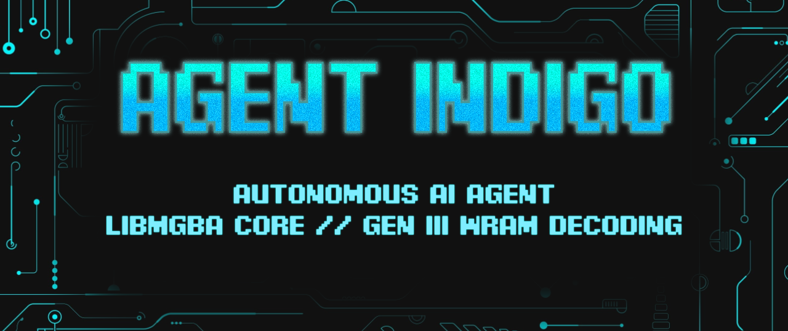

<p align="center">
  
</p>

<p align="center">
  <a href="https://github.com/haggyroth/agent-indigo/actions/workflows/ci.yml"></a>
  <a href="LICENSE"></a>
  
</p>

**Agent Indigo is an autonomous AI agent that plays Pokémon LeafGreen.** It runs the game in an in-process emulator, reads the game's memory directly (no screen-scraping required), and lets a large language model make the decisions — which route to take, which move to use, who to switch in, when to heal — while tested Python code does the button-level work.

It plays the whole story: a new game, eight gyms, Victory Road, the Elite Four and the Hall of Fame.

```text
   you  ──  python main.py  ──►  ┌─────────────────────────────────────────────────────────────┐
                                 │  observe        decide                act                   │
   LeafGreen ROM (yours)         │  ┌────────┐    ┌──────────────┐    ┌────────────────────┐   │
          │                      │  │ memory │──► │  LLM (tools) │──► │  skills            │   │
     libmgba (in-process) ◄──────┼──│ reader │    │  any OpenAI- │    │  go_to · use_move  │   │
          ▲                      │  └────────┘    │  compatible  │    │  catch · heal · …  │   │
          └────── button frames ─┼────────────────┴──────────────┴────┴────────────────────┘   │
                                 └─────────────────────────────────────────────────────────────┘
```

## Why it exists

Most "LLM plays a game" projects hand the model raw button presses and a screenshot. That makes the model spend its budget on menu timing and pathfinding, and makes every run unrepeatable. Agent Indigo splits the job instead:

- **The model decides *what*.** A destination, a move, a Pokémon to send in, a quest to start.
- **Code decides *how*.** Each tool is a deterministic skill — A* over the real tilemap, the exact menu cursor writes, verified outcomes read back from memory — that either succeeds, or fails cleanly and tells the model why.
- **The harness supplies the context a player would have.** The foe's types and ability, which of the model's moves are super-effective or have *no effect*, what the next gym needs, what the team lacks, which Pokémon a trainer is about to send out — the model should never have to guess what the game already knows.

That makes runs fast (~50× real time, headless), reproducible (deterministic frame stepping, checkpoints, per-save journals), and measurable (an eval harness scores real runs against goals).

## At a glance

| | |
|---|---|
| **Emulator** | [libmgba](https://mgba.io/) driven in-process through a small cffi binding — no GUI, no Lua, no network hop |
| **Observation** | Gen III RAM decoded directly: the XOR-encrypted party structs, badges, map, position, the battle structs, the script engine, the menu state |
| **Actions** | 41 high-level tools — navigation, battle, party & PC, shopping, quests for every story beat, HM field moves, and more ([full list](docs/tools.md)) |
| **Knowledge** | Maps, warps, shops, encounters, learnsets, gym teams and puzzle routes *generated from the [pokefirered](https://github.com/pret/pokefirered) decompilation*, not remembered from another game version |
| **Models** | Anything OpenAI-compatible **with tool calling** — LM Studio, Ollama, or a cloud endpoint ([models](docs/models.md)) |
| **Memory** | Per-save long-term journal and battle journal; emulator checkpoints you can resume ([details](docs/memory-and-logs.md)) |
| **Quality** | 1,000+ hardware-free unit tests, a 130-test live suite against the real ROM, and a goal-based eval harness ([testing](docs/testing.md)) |

## Quickstart

You need Python 3.11+, a C compiler, [libmgba](https://mgba.io/), a tool-calling LLM endpoint, and **your own legally obtained** Pokémon LeafGreen (US, v1.0) ROM — the repository contains none.

```sh
git clone https://github.com/haggyroth/agent-indigo.git
cd agent-indigo

python3 -m venv .venv && source .venv/bin/activate
pip install -r requirements.txt

brew install mgba                  # or your distro's libmgba package
python -m game._mgba_build         # compiles the cffi binding

cp .env.example .env               # set ROM_PATH and MODEL_NAME (and LLM_BASE_URL / LLM_API_KEY for a cloud model)
python main.py
```

Start a brand-new game with `START_NEW_GAME=true python main.py`, or continue a cartridge save with `START_FROM_SAVE=path/to/game.sav`. Add `SHOW_WINDOW=true` (needs `pip install pygame`) to watch it play. The [getting-started guide](docs/getting-started.md) walks through every option, local vs cloud models, and troubleshooting.

## What the agent can do

| Area | Tools (examples) |
|---|---|
| **Navigate** | `go_to("Pewter City" / "Pokemon Center" / "Mart" / "Gym")` routes across map connections, doors and caves, flies when that is faster, and stops for anything worth the model's attention; `walk_to(x, y)`, `go_to_map(direction)` |
| **Battle** | `use_move`, `switch_pokemon`, `use_item`, `catch`, `flee_battle`; the observation ranks moves by type effectiveness, STAB, immunities and foe abilities |
| **Build a team** | `team_report`, `inspect_pokemon` (IVs, nature, quality grade), `pc` (swap / deposit / withdraw), `reorder_party`, `teach_move`, `tutor`, `daycare` |
| **Keep going** | `heal`, `shop`, `grind(level)`, `fish`, `use_hm`, `fly_to`, `save_game`, `save_state` |
| **Play the story** | `quest(...)` — the story chain (39 beats, required and optional) from Oak's parcel to the Champion, each a resumable driver: gyms, SS Anne, Rocket Hideout, Silph Co., Pokémon Tower, Safari Zone, Victory Road, the League |
| **Recover** | `advance_dialog`, `close_menus`, `answer_prompt`, `read_game_state` |

Skills self-verify against memory, are resumable, and end on any encounter so the **model** plays every battle. The model is only offered the tools that fit the screen (about 1.2k tokens of tool schema in battle, 3.9k on the overworld).

## Watching, resuming and measuring

- **Watch:** `SHOW_WINDOW=true` opens a live pygame view; `LOG_LEVEL=events|debug` controls the terminal stream.
- **Resume:** the agent writes an emulator checkpoint (plus a journal snapshot) every 20 ticks and on every badge — `RESUME=latest python main.py` picks up where a run stopped.
- **One journal per save:** loading a save or state selects the journal that belongs to it, so an old fixture never inherits the milestones of a newer run.
- **Run logs:** every run writes `logs/runs/<timestamp>/run.jsonl` — each LLM call, tool call, event and observation — which makes watched runs easy to mine for bugs.
- **Measure:** `python -m evals` scores the real agent loop against goals (reach a city, earn badges, clear the League) with a step budget, and reports stuck-ratio, event statistics, calls and tokens.

## Documentation

| | |
|---|---|
| [Getting started](docs/getting-started.md) | Install, ROM, models, first run, new game vs save, troubleshooting |
| [Architecture](docs/architecture.md) | The decision loop, observation, skills, the knowledge layer, module boundaries |
| [Configuration](docs/configuration.md) | Every environment variable |
| [Tools](docs/tools.md) | The generated tool table |
| [Models](docs/models.md) | Choosing a model, context sizing, spend controls |
| [Memory, journals and logs](docs/memory-and-logs.md) | Long-term memory, per-save journals, checkpoints, run logs |
| [Testing](docs/testing.md) | Unit tests, the live suite, the eval harness |
| [Reference](docs/reference) | Gen III data structures, RAM map, game knowledge |
| [CLAUDE.md](CLAUDE.md) | The operational reference for AI coding assistants working in this repo |
| [CONTRIBUTING](CONTRIBUTING.md) · [CHANGELOG](CHANGELOG.md) | How to contribute · what changed and why |

## Project layout

```text
main.py            decision loop (build_runtime / run_episode)
config.py          settings from .env
agent/             LLM client, tool schemas, observation builder, skills/ (navigation, battle, quests, …)
game/              libmgba binding, memory reader, tilemap + pathfinding, viewer
knowledge/         type chart, maps, shops, encounters, gym teams, prompts (much of it generated)
memory/            short-term, long-term and per-save journals, battle journal, checkpoints, run log
evals/             goals, scenarios and the runner (python -m evals)
tools/             data generators (from the decomp), the live-suite runner, journal reset
tests/             unit tests; tests/live/ replays real bugs against the real ROM
docs/              guides and reference
```

## Responsible use

Agent Indigo is an independent research and hobby project. It is not affiliated with or endorsed by Nintendo, Game Freak, Creatures Inc. or The Pokémon Company; *Pokémon* and *LeafGreen* are their trademarks. No ROM, save, or game asset is included or distributed — you must supply your own legally obtained copy. The agent only observes memory and sets menu cursors the way a D-pad would; it does not modify save data, stats, RNG or battle outcomes (see [architecture](docs/architecture.md#what-the-agent-writes-to-memory)).

## Acknowledgements

- [mGBA](https://mgba.io/) (MPL-2.0) — the emulator core.
- [pret/pokefirered](https://github.com/pret/pokefirered) — the decompilation the knowledge tables are generated from.
- The community RAM maps credited in [docs/reference/ram-map.md](docs/reference/ram-map.md).

## License

[MIT](LICENSE).
